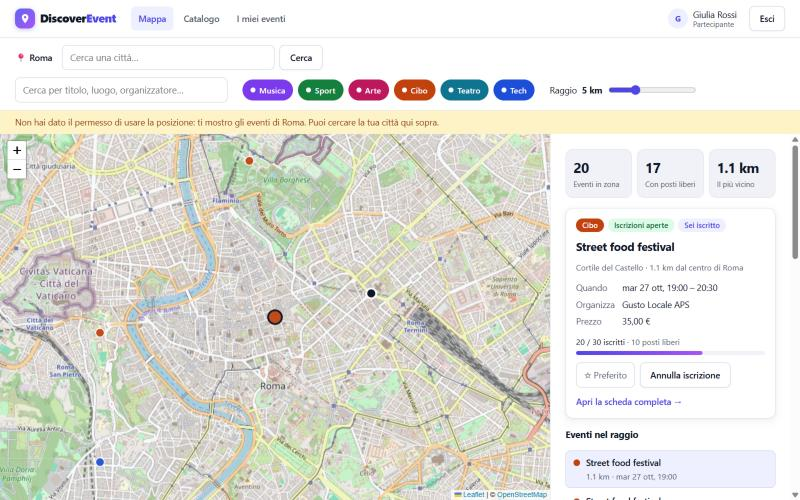
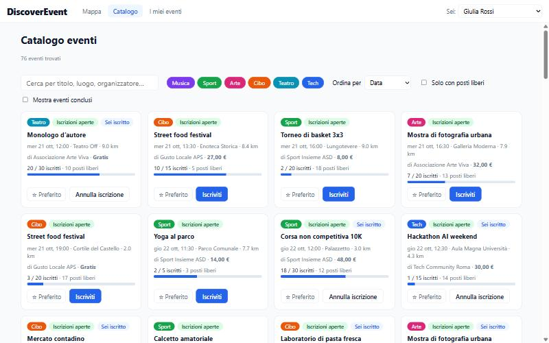

# DiscoverEvent

**Scopri gli eventi intorno a te, salva quelli che ti interessano e prenota il tuo posto.**

DiscoverEvent è una web app per trovare eventi nella propria zona: concerti, mostre, sport, food, teatro e meetup tecnologici. I partecipanti esplorano gli eventi su una mappa o in un catalogo, li salvano tra i preferiti e si iscrivono. Gli organizzatori pubblicano i propri eventi, ne gestiscono i posti e vedono chi si è iscritto.



## Funzionalità

**Per chi partecipa**
- **Mappa della zona**: gli eventi vicini sono mostrati sulla mappa, con il raggio di ricerca regolabile e una dashboard laterale con i dati dell'evento selezionato.
- **Catalogo**: ricerca per titolo, luogo o organizzatore, filtri per categoria, ordinamento per data, distanza o popolarità.
- **Scheda evento**: data e orari, luogo sulla mappa, descrizione, organizzatore, prezzo e posti disponibili.
- **Preferiti e iscrizioni**: un clic per salvare un evento o prenotare un posto; la pagina *I miei eventi* raccoglie entrambi.

**Per chi organizza**
- **Area organizzatore**: elenco dei propri eventi con iscritti, stato e percentuale di posti occupati.
- **Creazione e modifica** degli eventi, con il luogo scelto cliccando sulla mappa.
- **Lista iscritti** visibile solo all'organizzatore dell'evento.

**Account e ruoli**
- **Registrazione e accesso** con email e password; gli eventi si possono esplorare anche senza account.
- **Tre ruoli**: partecipante, organizzatore, amministratore.
- **Diventare organizzatore**: lo si chiede alla registrazione o in seguito dal profilo; un **amministratore** approva o rifiuta la richiesta dalla sua area.

**Stato delle iscrizioni**

Ogni evento mostra a colpo d'occhio se ci si può ancora iscrivere:

| Stato | Quando |
|---|---|
| Iscrizioni aperte | ci sono posti liberi |
| Ultimi posti | occupato almeno l'80% dei posti |
| Completo | raggiunto il limite di partecipanti |
| Concluso | l'evento è già iniziato |

Il limite di partecipanti è garantito dal server: anche con richieste simultanee non si superano i posti disponibili.



## Tecnologie

| Livello | Strumenti |
|---|---|
| Frontend | React 18, TypeScript, Vite, React Router |
| Mappe | Leaflet con OpenStreetMap |
| Backend | Node.js, Express |
| Autenticazione | Sessioni con cookie (express-session), password con bcrypt (bcryptjs), limite ai tentativi (express-rate-limit) |
| Database | SQLite (modulo `node:sqlite` integrato in Node.js) |
| Validazione | Zod, con le stesse regole su client e server |
| Test | `node:test` sulle API |

## Avvio rapido

Requisiti: **Node.js 22.13 o successivo**.

```bash
npm install
npm run dev
```

L'app è disponibile su http://localhost:5173 e l'API su http://localhost:3001/api.
Al primo avvio il database viene creato e popolato con dati dimostrativi nella zona di Roma.

| Comando | Cosa fa |
|---|---|
| `npm run dev` | Avvia frontend e backend insieme |
| `npm test` | Esegue i test delle API |
| `npm run build` | Controlla i tipi e crea la build di produzione |
| `npm run db:reset` | Cancella il database (viene ricreato al prossimo avvio) |

### Account dimostrativi

Nella pagina **Accedi** i pulsanti *Prova come partecipante / organizzatore / amministratore* entrano con un account demo, senza registrarsi. Tutti gli account demo usano la password `demo1234`:

| Ruolo | Email |
|---|---|
| Partecipante | `giulia.rossi@example.com` |
| Organizzatore | `techcommunity@example.com` |
| Amministratore | `admin@example.com` |

### Configurazione

Le impostazioni si leggono da variabili d'ambiente o da un file `.env` (vedi [`.env.example`](.env.example)). In sviluppo funzionano i valori predefiniti; in produzione (`NODE_ENV=production`) è obbligatoria `SESSION_SECRET` e i cookie viaggiano solo su HTTPS.

### Sicurezza

- Password salvate solo come hash **bcrypt**, mai in chiaro.
- Sessione in un cookie **`httpOnly`** (non leggibile dal JavaScript della pagina) e **`SameSite=Lax`** (non inviato dalle richieste di modifica di altri siti).
- Nuovo id di sessione a ogni accesso, per impedire il furto di sessioni preparate in anticipo.
- **Massimo 10 tentativi** di accesso o registrazione ogni 15 minuti per indirizzo IP.
- Stesso messaggio d'errore per email sconosciuta e password sbagliata, per non rivelare quali email sono registrate.

## Architettura

```
DiscoverEvent/
├── shared/          Tipi e regole di validazione comuni a client e server
├── server/          API REST (Express) e accesso al database (SQLite)
│   ├── app.ts         Rotte e controlli di permesso
│   ├── repository.ts  Tutte le query SQL
│   ├── sessionStore.ts  Sessioni di login salvate nel database
│   ├── db.ts          Schema del database
│   └── seed.ts        Dati dimostrativi
└── src/             Applicazione React
    ├── pages/         Una pagina per ogni sezione dell'app
    ├── components/    Mappa, card evento, filtri, badge di stato
    ├── context/       Stato condiviso: utente corrente ed eventi
    └── hooks/         Geolocalizzazione e filtri di ricerca
```

In sviluppo Vite inoltra le chiamate `/api` al server Express, quindi frontend e backend si usano come un'unica applicazione.

## API

| Metodo | Percorso | Descrizione |
|---|---|---|
| POST | `/api/auth/register` | Crea un account e accede |
| POST | `/api/auth/login` | Accesso con email e password |
| POST | `/api/auth/logout` | Uscita |
| GET | `/api/auth/me` | Utente corrente e stato della sua richiesta organizzatore |
| POST | `/api/organizer-requests` | Richiesta per diventare organizzatore |
| GET | `/api/admin/organizer-requests` | Elenco richieste (solo amministratori) |
| PUT | `/api/admin/organizer-requests/:id` | Approva o rifiuta (solo amministratori) |
| GET | `/api/events` | Tutti gli eventi, con preferito e iscrizione dell'utente corrente |
| GET | `/api/events/:id` | Dettaglio evento (con lista iscritti per l'organizzatore) |
| POST | `/api/events` | Crea un evento (solo organizzatori) |
| PUT | `/api/events/:id` | Modifica un proprio evento |
| DELETE | `/api/events/:id` | Elimina un proprio evento |
| PUT / DELETE | `/api/events/:id/registration` | Iscrizione / annullamento |
| PUT / DELETE | `/api/events/:id/favorite` | Aggiunge / rimuove dai preferiti |

Gli errori restituiscono `{ "error": "messaggio", "fields": { "campo": "messaggio" } }` con i codici HTTP 400, 401, 403, 404, 409 o 429.

## Sviluppi futuri

- Verifica dell'email e recupero della password
- Lista d'attesa quando un evento è completo
- Importazione di eventi reali da servizi esterni (es. Ticketmaster Discovery API)
- Immagini di copertina per gli eventi
- Notifiche di promemoria prima dell'evento

---

Progetto sviluppato con l'assistenza di [Claude Code](https://claude.com/claude-code).
Come è stato costruito, passo per passo: [Guida al progetto](docs/GUIDA-PROGETTO.md).
