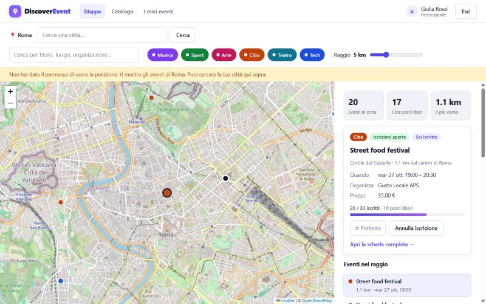
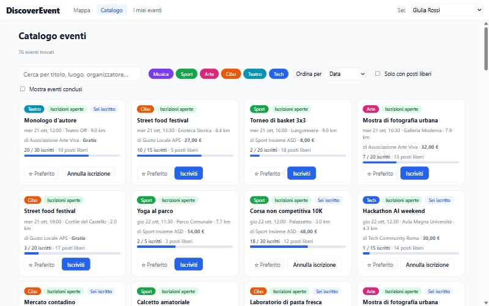

# DiscoverEvent

**Scopri gli eventi intorno a te, salva quelli che ti interessano e prenota il tuo posto.**

DiscoverEvent è una web app per trovare eventi nella propria zona: concerti, mostre, sport, food, teatro e meetup tecnologici. I partecipanti esplorano gli eventi su una mappa o in un catalogo, li salvano tra i preferiti e si iscrivono. Gli organizzatori pubblicano i propri eventi, ne gestiscono i posti e vedono chi si è iscritto.

**Prova la demo: <https://discoverevent.onrender.com>** — si entra con i pulsanti *Prova come…*, senza registrarsi. Il server gratuito si sospende quando nessuno lo usa: la prima apertura può richiedere circa un minuto.



## Funzionalità

**Per chi partecipa**
- **Mappa della zona**: gli eventi vicini sono mostrati sulla mappa, con il raggio di ricerca regolabile e una dashboard laterale con i dati dell'evento selezionato.
- **Catalogo**: ricerca per titolo, luogo o organizzatore, filtri per categoria, ordinamento per data, distanza o popolarità.
- **Scheda evento**: data e orari, luogo sulla mappa, descrizione, organizzatore, prezzo e posti disponibili.
- **Preferiti e iscrizioni**: un clic per salvare un evento o prenotare un posto; la pagina *I miei eventi* raccoglie entrambi.

**Per chi organizza**
- **Area organizzatore**: elenco dei propri eventi con iscritti, stato e percentuale di posti occupati.
- **Creazione e modifica** degli eventi, con il luogo scelto cliccando sulla mappa.
- **Lista iscritti** visibile solo all'organizzatore dell'evento.

**Account e ruoli**
- **Registrazione e accesso** con email e password; gli eventi si possono esplorare anche senza account.
- **Tre ruoli**: partecipante, organizzatore, amministratore.
- **Diventare organizzatore**: lo si chiede alla registrazione o in seguito dal profilo; un **amministratore** approva o rifiuta la richiesta dalla sua area.

**Stato delle iscrizioni**

Ogni evento mostra a colpo d'occhio se ci si può ancora iscrivere:

| Stato | Quando |
|---|---|
| Iscrizioni aperte | ci sono posti liberi |
| Ultimi posti | occupato almeno l'80% dei posti |
| Completo | raggiunto il limite di partecipanti |
| Concluso | l'evento è già iniziato |

Il limite di partecipanti è garantito dal server: anche con richieste simultanee non si superano i posti disponibili.



## Tecnologie

| Livello | Strumenti |
|---|---|
| Frontend | React 18, TypeScript, Vite, React Router |
| Mappe | Leaflet con OpenStreetMap |
| Backend | Node.js, Express |
| Autenticazione | Sessioni con cookie (express-session), password con bcrypt (bcryptjs), limite ai tentativi (express-rate-limit) |
| Database | SQLite (modulo `node:sqlite` integrato in Node.js) |
| Validazione | Zod, con le stesse regole su client e server |
| Sicurezza HTTP | helmet: Content Security Policy, HSTS, protezione dal clickjacking |
| Qualità | `node:test` sulle API, ESLint, Prettier, CI con GitHub Actions |
| Deploy | Docker, Render (staging e produzione), deploy di produzione sui tag di versione |
| Struttura | Monorepo con npm workspaces |

## Avvio rapido

Requisiti: **Node.js 22.13 o successivo**.

```bash
npm install
npm run dev
```

L'app è disponibile su http://localhost:5173 e l'API su http://localhost:3001/api.
Al primo avvio il database viene creato e popolato con dati dimostrativi in sei città italiane (Roma, Milano, Torino, Bologna, Napoli, Firenze).

| Comando | Cosa fa |
|---|---|
| `npm run dev` | Avvia frontend e backend insieme |
| `npm run check` | Tipi, lint, formattazione e test: gli stessi controlli della CI |
| `npm test` | Esegue i test delle API |
| `npm run format` | Formatta il codice con Prettier |
| `npm run build` | Crea la build di produzione del frontend |
| `npm start` | Avvia il server di produzione (serve anche il sito se è impostata `STATIC_DIR`) |
| `docker compose up --build` | Costruisce e avvia l'immagine Docker su http://localhost:8080 (vedi [Deploy e rilasci](#deploy-e-rilasci)) |
| `npm run db:reset` | Cancella il database (viene ricreato al prossimo avvio) |

### Account dimostrativi

Nella pagina **Accedi** i pulsanti *Prova come partecipante / organizzatore / amministratore* entrano con un account demo, senza registrarsi. Tutti gli account demo usano la password `demo1234`:

| Ruolo | Email |
|---|---|
| Partecipante | `giulia.rossi@example.com` |
| Organizzatore | `techcommunity@example.com` |
| Amministratore | `admin@example.com` |

L'amministratore demo è attivo in sviluppo e in modalità demo; in produzione senza modalità demo (`NODE_ENV=production`) non può accedere, non viene creato su un database nuovo e il suo pulsante sparisce. Si può forzare con `DEMO_ADMIN_ENABLED` (vedi [`apps/api/.env.example`](apps/api/.env.example)).

### Modalità demo (sito pubblico)

Il sito pubblico gira con `DEMO_MODE=true`, per non raccogliere dati personali reali (minimizzazione dei dati, GDPR):

- la **registrazione è disattivata**: il server risponde 403 e la pagina *Registrati* rimanda agli account demo;
- si entra solo con i **tre account demo**, amministratore compreso;
- **ogni notte alle 4** (ora italiana) il database torna ai dati demo iniziali e tutti escono dall'account.

L'azzeramento è un timer dentro il server, senza librerie in più: ogni 5 minuti controlla se sono passate le 4 e, in una transazione, svuota le tabelle e rilancia i dati demo. Limiti: se il server è spento alle 4 l'azzeramento salta fino alla notte dopo (oppure avviene al riavvio, se il disco dell'hosting non è permanente); con più copie del server ognuna azzererebbe il database per conto suo, quindi va usata una sola istanza (come già richiede SQLite).

Senza `DEMO_MODE` (in locale, per esempio) tutto funziona come prima, registrazione compresa.

### Informativa privacy

Titolare ed email della pagina *Privacy* non sono scritti nel codice: si impostano sull'hosting con `PRIVACY_CONTROLLER_NAME` e `PRIVACY_CONTACT_EMAIL`. Il frontend li legge all'avvio da `GET /api/config`, quindi si cambiano senza ricompilare. Se mancano, la pagina mostra una frase neutra.

### Configurazione

Le impostazioni del server si leggono da variabili d'ambiente o dal file `apps/api/.env` (vedi [`apps/api/.env.example`](apps/api/.env.example)). In sviluppo funzionano i valori predefiniti; in produzione (`NODE_ENV=production`) è obbligatoria `SESSION_SECRET` e i cookie viaggiano solo su HTTPS (`SECURE_COOKIES=false` solo per provare l'immagine su http://localhost).

### Creare il primo amministratore

In produzione l'amministratore demo è disattivato. Per avere un vero amministratore:

1. registra normalmente l'account dall'app (pagina **Registrati**), con la tua password;
2. sul server, dalla radice del progetto, esegui:

   ```bash
   npm run admin:promote -w @discoverevent/api -- tua.email@esempio.it
   ```

Il comando usa lo stesso database del server (`DB_PATH`), non crea account e non chiede né salva password: cambia solo il ruolo di un utente esistente. Se l'email non è registrata lo dice e non modifica nulla.

### Sicurezza

- Password salvate solo come hash **bcrypt**, mai in chiaro.
- Sessione in un cookie **`httpOnly`** (non leggibile dal JavaScript della pagina), **`SameSite=Lax`** (non inviato dalle richieste di modifica di altri siti) e **`Secure`** in produzione (solo su HTTPS).
- **Header di sicurezza** con helmet: la Content Security Policy permette script e immagini solo dal sito e dalle tile di OpenStreetMap; HSTS impone HTTPS; il sito non può essere incorniciato da altri.
- Nuovo id di sessione a ogni accesso, per impedire il furto di sessioni preparate in anticipo.
- **Massimo 10 tentativi** di accesso o registrazione ogni 15 minuti per indirizzo IP.
- Stesso messaggio d'errore per email sconosciuta e password sbagliata, per non rivelare quali email sono registrate.

## Deploy e rilasci

Il sito gira su [Render](https://render.com) in un container Docker. I servizi sono descritti in [`render.yaml`](render.yaml), la pipeline in [`.github/workflows/ci.yml`](.github/workflows/ci.yml).

| Ambiente | Indirizzo | Si aggiorna |
|---|---|---|
| Sviluppo | http://localhost:5173 (`npm run dev`) | A ogni salvataggio |
| Staging | <https://discoverevent-staging.onrender.com> | Da solo a ogni merge su `main`, se la CI è verde; escluso dai motori di ricerca (`NOINDEX`) |
| Produzione | <https://discoverevent.onrender.com> | Solo quando si pubblica un tag di versione `vX.Y.Z` |

```
PR → CI verde → merge su main → staging → prove → PR di rilascio → tag vX.Y.Z → CI → produzione
```

**Pubblicare una versione**

1. Ogni PR aggiunge le sue novità alla sezione *Non ancora rilasciato* di [`CHANGELOG.md`](CHANGELOG.md).
2. Provate le novità sullo staging, una PR di rilascio aggiorna i numeri di versione e il changelog:
   ```bash
   npm version 1.1.0 --workspaces --include-workspace-root --no-git-tag-version
   ```
3. Dopo il merge, il tag si crea **su `main` aggiornato**:
   ```bash
   git switch main && git pull
   git tag -a v1.1.0 -m "DiscoverEvent 1.1.0"
   git push origin v1.1.0
   ```
4. La CI rifà tutti i controlli; se passano, chiama il deploy hook di Render (segreto `RENDER_DEPLOY_HOOK` nell'ambiente `production` di GitHub, utilizzabile solo dai tag `v*`) e va online esattamente quel commit.

Le versioni seguono il [Semantic Versioning](https://semver.org/lang/it/): `1.0.1` corregge, `1.1.0` aggiunge, `2.0.0` cambia qualcosa in modo non compatibile. Un tag pubblicato non si sposta: per correggere si rilascia una nuova versione.

**Provare l'immagine di produzione in locale**

```bash
docker compose up --build
```

Il sito è su http://localhost:8080. `SESSION_SECRET` si legge dal file `.env` nella radice del progetto (escluso da Git e da Docker). Le impostazioni valide solo su un PC, per esempio il certificato di un antivirus che intercetta l'HTTPS, vanno in `compose.override.yaml`, che non si committa.

Su Render il disco gratuito non è permanente: a ogni deploy o riavvio il database riparte dai dati demo, cosa compatibile con la modalità demo. Con utenti reali servirebbe un disco persistente (`DB_PATH`) o un database gestito.

## Architettura

Monorepo con **npm workspaces**: frontend e backend sono applicazioni separate, ognuna con le sue dipendenze, che condividono un pacchetto comune. Il codice è organizzato **per funzionalità**: tutto ciò che riguarda, ad esempio, il login sta nella stessa cartella.

```
DiscoverEvent/
├── apps/
│   ├── api/                    Backend: API REST con Express e SQLite
│   │   └── src/
│   │       ├── modules/          Una cartella per funzionalità: rotte, query SQL e test
│   │       │   ├── auth/
│   │       │   ├── events/
│   │       │   ├── organizer-requests/
│   │       │   ├── site-config/  GET /api/config (modalità demo, dati privacy)
│   │       │   └── demo-reset/   Azzeramento notturno dei dati demo
│   │       ├── middleware/       Sessione, utente corrente, gestione errori
│   │       ├── db/               Schema, migrazioni, dati demo, sessioni
│   │       └── config.ts         Variabili d'ambiente validate all'avvio
│   └── web/                    Frontend: applicazione React
│       └── src/
│           ├── features/         Una cartella per funzionalità: pagine, componenti, stato
│           │   ├── auth/
│           │   ├── events/
│           │   ├── organizer/
│           │   ├── admin/
│           │   └── site-config/  Configurazione del sito letta all'avvio
│           ├── components/       Componenti generici (campi, notifiche, intestazione)
│           └── lib/              Client API, formattazione, utilità
└── packages/
    └── shared/                 Tipi e regole di validazione comuni a frontend e backend
```

In sviluppo Vite inoltra le chiamate `/api` al server Express, quindi frontend e backend si usano come un'unica applicazione.

## API

| Metodo | Percorso | Descrizione |
|---|---|---|
| GET | `/api/config` | Configurazione pubblica: modalità demo, titolare ed email della privacy |
| POST | `/api/auth/register` | Crea un account e accede (403 in modalità demo) |
| POST | `/api/auth/login` | Accesso con email e password |
| POST | `/api/auth/logout` | Uscita |
| GET | `/api/auth/me` | Utente corrente e stato della sua richiesta organizzatore |
| POST | `/api/organizer-requests` | Richiesta per diventare organizzatore |
| GET | `/api/admin/organizer-requests` | Elenco richieste (solo amministratori) |
| PUT | `/api/admin/organizer-requests/:id` | Approva o rifiuta (solo amministratori) |
| GET | `/api/events` | Tutti gli eventi, con preferito e iscrizione dell'utente corrente |
| GET | `/api/events/:id` | Dettaglio evento (con lista iscritti per l'organizzatore) |
| POST | `/api/events` | Crea un evento (solo organizzatori) |
| PUT | `/api/events/:id` | Modifica un proprio evento |
| DELETE | `/api/events/:id` | Elimina un proprio evento |
| PUT / DELETE | `/api/events/:id/registration` | Iscrizione / annullamento |
| PUT / DELETE | `/api/events/:id/favorite` | Aggiunge / rimuove dai preferiti |

Gli errori restituiscono `{ "error": "messaggio", "fields": { "campo": "messaggio" } }` con i codici HTTP 400, 401, 403, 404, 409 o 429.

## Sviluppi futuri

- Verifica dell'email e recupero della password
- Lista d'attesa quando un evento è completo
- Importazione di eventi reali da servizi esterni (es. Ticketmaster Discovery API)
- Immagini di copertina per gli eventi
- Notifiche di promemoria prima dell'evento

---

Progetto sviluppato con l'assistenza di [Claude Code](https://claude.com/claude-code).
Come è stato costruito, passo per passo: [Guida al progetto](docs/GUIDA-PROGETTO.md) · [Lavorare con più sessioni di Claude Code](docs/SESSIONI-PARALLELE.md).
